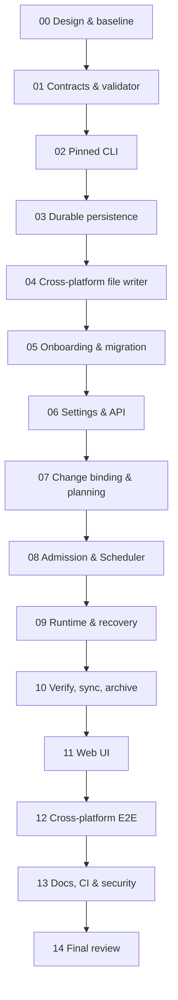

# Plan 29 — Mandatory OpenSpec for All Managed Projects

> **Статус `proposed`, не `approved`.** Это **новый продуктовый план**, НЕ изменение Plan 28. План 28 переводит на OpenSpec процесс разработки **самого репозитория** Ebb Orchestrator; Plan 29 внедряет OpenSpec в **работающий Ebb Orchestrator**, чтобы Ebb разрабатывал **любые добавленные пользователем проекты** только через OpenSpec. Ни один пункт ниже ещё не реализован и не протестирован. До implementation обязательны согласование load-bearing design, fresh `ebb-review-plan` и повторная проверка текущего `develop`.
>
> **Метод разработки плана:** паттерны Superpowers `brainstorming`, `writing-plans`, `test-driven-development`, `subagent-driven-development`, `verification-before-completion` и утверждённые `ebb-*` инварианты. Сам плагин/навык Superpowers в текущем окружении не был доступен для исполнения; применена его опубликованная методология. Не внедрять Superpowers как runtime dependency.
>
> **Место в roadmap:** `docs/architecture/plans/29-mandatory-openspec-managed-projects.md`. Пока Plan 28 находится только в предложении, запись `depends_on: plan-28` добавлять в канонический реестр **только одновременно с включением Plan 28** — проверка docs governance не должна получать dangling dependency. Если Plan 28 ещё не принят/не интегрирован, Plan 29 остаётся самостоятельным читаемым проектом и **не исполняется**.

## 0. Что пользователь утвердил и чего нельзя переосмысливать

1. **OpenSpec обязателен для ВСЕХ managed projects** Ebb Orchestrator независимо от языка, менеджера пакетов, ОС, типа задачи и выбранной Agent Runtime. Нет переключателя `OpenSpec: off`, Standalone Mode, Ebb-only fallback и режима «только рекомендации».
2. Все 12 OpenSpec workflows должны быть **доступны и корректно маршрутизироваться**. Это НЕ означает последовательный вызов каждого из двенадцати для каждого изменения: некоторые альтернативные (`propose`/`new`/`continue`/`ff`), некоторые служебные (`onboard`, `bulk-archive`).
3. У каждого проекта должна быть **настраиваемая, versioned, обозримая и согласуемая** OpenSpec-конфигурация. Любое изменение approval-bound параметров проходит существующий Project Config candidate → review → exact-hash approval → безопасную активацию. `OpenSpec required` и безопасность — **не редактируемые** политики продукта.
4. **OpenSpec отвечает за WHAT/WHY, specifications, design и tasks**; **Ebb остаётся единственным authoritative владельцем** project/epic/task/run states, Scheduler, permissions, budgets, agent selection, Git/worktrees, recovery, approval, QA, integration. Не создавать вторую конкурирующую state machine или самостоятельного OpenSpec worker, который обходит Ebb.
5. Отсутствие бинарника, навыка, правильной версии, project config, change artifacts, approval, актуального context fingerprint, права на запись или проверенного состояния влечёт **машинно-читаемый BLOCKED**, не самостоятельную реализацию.
6. Read-only discovery/triage/explore возможно до появления нового change; **первый mutating product-development шаг** (включая bugfix, test/doc/config) требует approved/bound OpenSpec change и санкционированной capability. Первичная техническая настройка OpenSpec в новом проекте — единственный отдельный onboarding/provisioning workflow с review, а не альтернативный способ писать продуктовый код.
7. Project Config в `.ebb-orchestrator/` **не равен** OpenSpec `openspec/config.yaml`; оба имеют разных владельцев, а настройки должны быть согласованы и snapshot-bound. Не подменять approval сохранением UI-формы и не объявлять состояние «ACTIVE» до подтверждённого применения в repository.
8. Никакой автоматический release/deploy/публикация, внешний сетевой доступ, выполнение hooks, создание внешнего store или Git push без существующей явной политики разрешений.

### Вне scope

- Не заменять GitHub Issues, Epics, Tasks, Runs, WorkflowEngine на OpenSpec внутренне.
- Не мигрировать старые completed Epic/Tasks в фиктивные OpenSpec history, не удалять legacy спецификации и документы, не переписывать Git history.
- Не подключать remote OpenSpec stores по умолчанию (`store`/`references` требуют отдельного проектного разрешения и network policy); не делать store/workset обязательной частью первого релиза интеграции.
- Не переводить SQLite в PostgreSQL в рамках этого плана; additive forward-only migration по текущей политике.
- Не пытаться одновременно заменить Hermes Runtime на Codex Runtime: runtime-agnostic `SpecificationProvider` должен поддержать Codex после появления его адаптера.

## 1. Подтверждённая база кода на `develop` (2026-10-30)

Repository: `vivernet/ebb-orchestrator`. **Точный full HEAD SHA извлечь перед стартом Task 00**. Изучены фактические файлы/интерфейсы:

| Область | Существующие owner/source | Вывод для интеграции |
|---|---|---|
| Project discovery & onboarding | `apps/server/src/modules/projects/repository-discovery.ts`, `onboarding-service.ts`, `apps/server/src/app/routes/onboarding.ts` | Сейчас discovery определяет Git/стек/`.ebb-orchestrator`; OpenSpec facts и утверждённого provisioning пока нет. |
| Project Config | `apps/server/src/modules/projects/project-config-service.ts`, `project-config-repository.ts`, `apps/server/src/platform/config/project-config.ts`, `packages/contracts/src/reference-projections.ts`, `apps/server/src/app/routes/project-config.ts` | Есть immutable candidates/revisions, exact hash approval и write journal. OpenSpec — отдельное approved поле и отдельный allowlisted writer. |
| Project Config ограничение Windows | `project-config-service.ts`: `capture`/editor сейчас отвергают `win32`, `PROJECT_CONFIG_UNSUPPORTED_PLATFORM` | **Обязательный precondition:** Windows-safe capture/write для нового OpenSpec provisioning и настройки, либо полностью проверенная альтернативная cross-platform mutation path; запрещён POSIX-only rollout как «готовый». |
| Default dispatch | `apps/server/src/modules/scheduler/project-dispatch-guard.ts`, `scheduler-run-request-worker.ts`, `scheduler-service.ts` | Guard проверяет onboarding и integrity Config; legacy Project Config без state **сейчас допускается**. OpenSpec-admission должен убрать fail-open для всех проектов после миграции. |
| Planning | `apps/server/src/modules/planning/coordinator-planning-job.ts`, `planning-service.ts`, `epic-orchestrator.ts`, `plan-validator.ts` | Coordinator/PM/Architect уже создают durable plans/epics. Теперь каждый change должен быть связан с approved OpenSpec artifacts до dispatch реализации. |
| Runtime & provenance | `apps/server/src/modules/runtime/run-service.ts`, `run-context-assembler.ts`, `prompt-builder.ts`, `apps/server/src/modules/context/context-manifest.ts`, `apps/server/src/modules/execution/action-gateway.ts` | Не доверять model output. Запинить OpenSpec spec/config/change hashes + CLI version в ContextManifest/Run/capability. |
| Deterministic workflow | `apps/server/src/modules/workflow/workflow-engine.ts`, `apps/server/src/modules/workflow/templates.ts` | OpenSpec lifecycle является gate/phase binding; новые task states из OpenSpec не подменяют Ebb states. |
| Web UI | `apps/web/src/features/projects/ProjectConfigPanel.tsx`, `ProjectPage.tsx`, `apps/web/src/features/onboarding/ProjectOnboardingPage.tsx`, `apps/web/src/features/settings/SettingsPage.tsx`, `apps/web/src/features/epics/EpicPage.tsx`, `apps/web/src/features/tasks/TaskPage.tsx` | Нужны OpenSpec tab/section в Project Settings, onboarding и project/change status, не только глобальная настройка. |
| API contracts | `packages/contracts/src/reference-projections.ts`, `api.ts`, `index.ts`; `apps/server/src/app/create-app.ts` | Все новые DTO — shared Zod strict, контракты/ошибки типизированы и зарегистрированы в production composition. |
| SQLite migrations | `apps/server/src/platform/database/migrations/033_project_config_lifecycle.sql`, `055_project_config_write_journal.sql` | Новые таблицы additive, migration next number выбирать от latest актуального checkout (после 055 если порядок сохранился). |
| CI/tests/docs | `package.json`, `apps/server/test/{app,modules,e2e}/`, `packages/contracts/test/`, `.github/workflows/production-gates.yml`, `docs/architecture/`, `.agents/skills/` | Запустить детерминированные focused и full gates, Win/Linux/macOS/E2E, независимый review и docs sync. |

**Выявленные опасные несовпадения:**

- `projectConfigDispatchAllowedTx()` возвращает `true` при отсутствии lifecycle schema/state — требуется новое обязательное проверяемое состояние OpenSpec, нельзя наследовать этот легаси-bypass.
- На Windows current Project Config capture/editor запрещены — без cross-platform решения невозможно честно обещать «всем проектам».
- OpenSpec `openspec/config.yaml` не является строго ошибочно-отказной конфигурацией: CLI **предупреждает и игнорирует неверные поля**; OpenSpec-specific approval и Ebb strict schema validation необходимы.
- OpenSpec профиль **12 workflows** — в **CLI/global profile**, а не в `openspec/config.yaml`. Ebb обязан управлять воспроизводимой версией и skill delivery отдельно от project config, не требовать изменения глобальных пользовательских настроек.
- OpenSpec `status --all --json` с **нулём изменений возвращает exit 0**. Наличие бинарника/пустого списка НЕ доказывает, что проект имеет approved change для реализации.

## 2. Design: два слоя, одна authority

```text
Ebb Orchestrator (authoritative)
  Project onboarding / Settings / Project Config approval
         |
         v
  SpecificationProvider port (deterministic API)
         |
         v
  OpenSpecAdapter + validated CLI bridge (pinned binary + controlled cwd)
         |
         +-- openspec/config.yaml
         +-- openspec/specs/**
         +-- openspec/changes/<changeId>/{.openspec.yaml,proposal.md,design.md,specs/**,tasks.md}
         +-- OpenSpec skills installed for supported agent tools (all 12)
         |
         v
  Ebb ChangeBinding (Project + Request/Epic + task mappings + hashes + approvals)
         |
         +-- Coordinator/PM/Architect planning gates
         +-- Scheduler/Run/permissions capability gates
         +-- Developer/Reviewer/QA/E2E evidence
         +-- Git integration + verify + sync + archive (durable)
```

**Authority matrix**

| Данные / переход | Authority | Другой слой |
|---|---|---|
| Тексты и статус OpenSpec proposal/specs/design/tasks | `OpenSpec` tracked artifacts + checked CLI | Ebb сохраняет validated immutable snapshot/reference/hash |
| Project/Run/Epic/Task status, budgets, retries, approvals | Ebb DB + deterministic services | OpenSpec не изменяет эти поля напрямую |
| Имя change ↔ Project/Epic, task checkbox ↔ Ebb Task | Ebb `ChangeBindingRepository` | OpenSpec даёт IDs/paths исходных tasks |
| Изменение project OpenSpec config | Ebb Project Config approval and managed writer | `openspec/config.yaml` — версии, права/байты, строго проверяется |
| Branch/worktree/merge | Ebb Git service | Изменения OpenSpec — обычные versioned Git files |
| Archive | Ebb transition + approved OpenSpec archive operation | CLI файловое действие под контролем capabilities; no auto release |

### 2.1 Предлагаемый внутренний контракт

**Создать** `apps/server/src/modules/specifications/specification-provider.ts`:

```ts
export type OpenSpecWorkflow =
  | "explore" | "propose" | "new" | "continue" | "ff" | "apply"
  | "update" | "verify" | "sync" | "archive" | "bulk-archive" | "onboard";

export type OpenSpecProjectHealth =
  | "NOT_CONFIGURED" | "CONFIG_PENDING_APPROVAL" | "PROVISIONING"
  | "READY" | "DRIFTED" | "BLOCKED" | "DEGRADED";

export interface OpenSpecProjectIdentity {
  readonly projectId: string;
  readonly repositoryRoot: string; // resolved from approved onboarding, never user-supplied in Run
  readonly configRevisionId: string;
  readonly configHash: string;    // sha256 of approved openspec/config.yaml bytes
  readonly cliVersion: string;
  readonly profileHash: string;   // locked all-12 profile manifest, no user-global config reliance
}

export interface OpenSpecChangeIdentity {
  readonly projectId: string;
  readonly changeId: string;
  readonly changeRevisionHash: string; // digest of allowed artifact manifest
  readonly sourceHead: string;         // exact Git identity when snapshot bound
  readonly schemaName: string;
}

export interface SpecificationProvider {
  inspectProject(projectId: string): Promise<OpenSpecProjectInspection>;
  validateProject(projectId: string, approvedRevisionId: string): Promise<OpenSpecValidationReport>;
  inspectChange(projectId: string, changeId: string): Promise<OpenSpecChangeInspection>;
  readApplyInstructions(projectId: string, changeId: string): Promise<OpenSpecApplyInstructions>;
  validateChange(projectId: string, changeId: string): Promise<OpenSpecValidationReport>;
}
```

`OpenSpecProjectInspection`, `OpenSpecChangeInspection`, `OpenSpecApplyInstructions`, `OpenSpecValidationReport` должны быть **строго определены в Task 01** в `specification-types.ts` с versioned schema; не принимать arbitrary JSON как authority. В этих типах обязателен `schemaVersion`, `status`, `source/manifest hashes`, machine error code, stdout provenance, explicit `unavailable` vs success. **Mutating операции** (`initialize`, `stageChangeArtifacts`, `sync`, `archive`) — НЕ в read-only provider port; обособить `SpecificationCommandService` с Action Gateway и durable journal, строгими approval/capability checks. Не использовать универсальный `runCommand(string)` endpoint.

### 2.2 Проектные настройки OpenSpec

**Глобальная политика Ebb (не отключаемая):** `required: true`, `all12Workflows: true`, `failClosed: true`, `specGateBeforeImplementation: true`, `verifyBeforeCompletion: true`, `archiveAfterIntegration: true`. Не сохранять как пользовательские boolean toggles: это versioned policy/invariant.

**Редактируемые настройки проекта** (новый `ProjectConfigV3`/`OpenSpecProjectSettingsV1`; точный schema authority в `packages/contracts/src/openspec.ts`, переэкспорт в `index.ts`):

| Поле UI/contract | Значения и правила | Где применяется |
|---|---|---|
| `schema` | `spec-driven` (default) или **подтверждённая installed project-local schema**; запрещено несуществующее имя | `openspec/config.yaml.schema` |
| `context` | UTF-8, макс. 50KB, reject secret-like values; никаких скрытых injected commands | `.context` |
| `rules.proposal` / `rules.specs` / `rules.design` / `rules.tasks` | списки bounded строк, allowlisted artifact IDs для текущей schema | `.rules` |
| `operations.apply.guidance` / `.archive.guidance` | bounded списки инструкций, policy не может разрешить нарушение Ebb gates | `.operations` |
| `store` | **в v1 product phase только локальный repo**. Если поле есть в external config — `BLOCKED_UNSUPPORTED_STORE`; не silently ignore | OpenSpec root resolution |
| `references` | по умолчанию `[]`. External sources — отдельное security-reviewed расширение, не импортировать по умолчанию | OpenSpec context references |
| `cliVersion` | read-only pinned Ebb-managed executable version; не из произвольного repo binary | version + provenance |
| `workflows` | read-only 12/12; отображать discovery status, не чекбоксы отключения | hermetic profile + runtime skill discovery |
| `status`, `approvedRevision`, `sourceHead`, `configHash` | read-only live/approved metadata, `pending`, `drift`, `blocked` | Project Settings и Run provenance |

**Минимальный проектный config, формируемый кандидатом** (пример, не готовый production policy):

```yaml
schema: spec-driven
context: |
  Используй архитектурные и security-правила этого проекта.
  Все изменения реализации требуют утверждённого OpenSpec change.
rules:
  proposal:
    - Явно фиксируй цель и границы изменения.
  specs:
    - Формулируй проверяемые сценарии приёмки.
  design:
    - Указывай риски, восстановление и совместимость.
  tasks:
    - Для каждой задачи нужны RED/GREEN и конкретные проверки.
operations:
  apply:
    guidance:
      - Выполняй только утверждённые задачи под контролем Ebb.
  archive:
    guidance:
      - Архивируй только после подтверждённой интеграции и QA.
```

Этот YAML является **дополнительным контекстом агенту**, не security boundary. Ebb backend отдельно проверяет approved state, mode и provenance — даже если агент проигнорировал инструкции.

**Разделение Config:** `.ebb-orchestrator/project.yaml` оставляем в его существующей версии/owner; OpenSpec settings становятся новым `OpenSpecProjectSettingsV1` в approved Ebb candidate, рендерятся в **`openspec/config.yaml`** отдельным deterministic renderer. Не записывать в `.ebb-orchestrator/project.yaml` поля OpenSpec — его строгая `schema_version: 1` их отклонит. Не менять существующие approved `ProjectConfigV1/V2` задним числом: добавить `ProjectConfigV3` с миграцией и совместимым чтением старых revisions.

### 2.3 Установка во все репозитории

- Ebb **не требует Node/pnpm в управляемом Python/Go/Rust/другом проекте**: запускает проверенный Ebb-owned CLI OpenSpec с фиксированной версией из app-managed installation, без `npx` на лету, без загрузки пакетов через runtime. `1.15.0` использовать как первоначальный pinned baseline согласно Plan 28; перед implementation заново проверить compatibility/версию.
- Installation/provisioning генерирует только **allowlisted** файлы OpenSpec, под отдельной утверждённой Git task branch/worktree целевого репозитория, с diff и approval; никакого незаметного изменения его `main`/`master`/`develop`.
- 12 навыков устанавливаются для фактически поддерживаемой Agent Runtime (Hermes обязательно, Codex когда runtime адаптер существует). **Все 12 workflow поддерживаются через Ebb API/agent orchestration**, даже если UI разрешает пользователю только релевантные действия. Наличие сгенерированных skill файлов без discovery smoke недостаточно.
- OpenSpec CLI global profile — **не** источник истины. Единый Ebb-owned профиль/manifest в приложении (или pinned Plan 28 manifest, если интегрирован) + временный per-Run CLI config home. Не записывать в `%APPDATA%` пользователя и не менять настройки других проектов.
- Existing repo config/discovered changes/specs — **недоверенный исходный ввод**; импорт как candidate и human review, никакой `init --force`/overwrite без согласованного diff. Existing tool skill files (`.agents/skills/`, `.hermes/skills/`) и `AGENTS.md` нельзя автоматически перезаписывать вслепую.
- Windows safety: использовать approved scoped Git operations и гарантированную защиту от symlink/reparse, path traversal, TOCTOU, `.git` indirection, чужих worktrees и partial writes. Если Windows-safe writer не доказан, setup и dispatch **BLOCKED** на Windows, а не незаметно выполнены небезопасно.

### 2.4 Жизненный цикл одного изменения

```text
REQUEST (read-only triage/explore разрешён)
  -> Project OpenSpec READY + pinned config + Ebb admission
  -> choose [propose | new -> continue | ff] (или update existing change)
  -> OpenSpec artifacts validated (proposal/specs/design/tasks)
  -> Ebb approval proposal/design/task mapping, immutable hashes
  -> Ebb Request/Epic/Task binding (many tasks to 1 change; no cross-project)
  -> implementation [openspec apply instructions + Ebb task subagents]
  -> Ebb independent review + QA + openspec verify (semantic checks + deterministic gates)
  -> approved Ebb Git integration + post-integration proof
  -> openspec sync (if required, with own Git-scope approval and verified source)
  -> openspec archive in durable, separately integrated lifecycle step
  -> CLOSED (no release/deploy side effect)
```

**Синхронизация vs Git:** `sync` должен попасть в **проверенный source/merge** до финального закрытия. Если спецификации нужно синхронизировать до интеграции, это часть change branch и повторного verify; если только после, создаётся отдельная разрешённая lifecycle-ветка с explicit git integration и post-integration checks. `archive` всегда после verified implementation integration и сохраняет однозначный closure SHA; никогда не изменяет код в `develop` скрыто. При конфликте spec изменений — `BLOCKED_SPEC_CONFLICT`, не автоматический force overwrite.

## 3. Полная карта всех 12 workflow

| Workflow | Product-level действие Ebb | Предусловия / ограничения |
|---|---|---|
| `explore` | Read-only изучение и обсуждение | Не создаёт implementation authority; минимальные read tools |
| `propose` | Новый change со всеми planning artifacts | Ebb Project READY; approved candidate из model output only after validation |
| `new` | Создаёт change scaffold | Не запускает implementer |
| `continue` | Создаёт следующий artifact по CLI `status` | Артефакты и source revision должны совпадать |
| `ff` | Быстрая подготовка всего change | **Те же** строгие Ebb approval и quality gates, не shortcut для execution |
| `apply` | Выполняет задачи через Ebb Task/Run | Только approved binding; каждый task → Run/capability/review |
| `update` | Пересматривает proposal/specs/design/tasks | Новые hashes инвалидируют старое approval и не разрешают silent continuation |
| `verify` | Контроль полноты и соответствия | Независимый reviewer/QA + deterministic tests, не только модельный вывод |
| `sync` | Синхронизирует delta specs | Подтверждённый diff/Git owner и конфликтные проверки |
| `archive` | Архивирует один change | Только после merged SHA, post-integration gates и exact archive evidence |
| `bulk-archive` | Пакетная архивация | Только явный запрос + per-change proof; partial failures, idempotency |
| `onboard` | Пробный end-to-end flow / обучение проектной команде | Не меняет продуктовый код без change approval; безопасный demo/explicit target |

**Реальные CLI signals:** `openspec schemas --json`, `openspec status --change <id> --json`, `openspec instructions apply --change <id> --json`, `openspec validate <id> --strict`, `openspec list --json` (на основании актуальных CLI docs). Некоторые OpenSpec workflows являются навыками агента, а **не самостоятельными терминальными командами**. Запретить имитацию «команды `openspec verify`» вместо реального `openspec-verify-change` + Ebb checks. CLI `status` оценивает *наличие артефактов*, а не product approval. Exact JSON keys/flags проверить против pinned CLI в Task 00, не выводить из догадки.

## 4. Исполнение, согласования, security и восстановление

### 4.1 Durable states и связи

Предлагаемые таблицы (имена versioned, финальные DDL создаются только после архитектурного approval):

- `openspec_project_state`: `project_id` PK, `state` enum (`NOT_CONFIGURED`,`PENDING_APPROVAL`,`PROVISIONING`,`READY`,`DRIFTED`,`BLOCKED`,`DEGRADED`), `config_revision_id`, `config_hash`, `cli_version`, `profile_hash`, `repository_head`, `version`, `updated_at`, `last_error_code`. Отсутствующая запись **блокирует mutating dispatch** после миграционного gate.
- `openspec_changes`: `id` UUID PK, `project_id` FK, `change_id` folder-safe, `status` (`DRAFT`,`ARTIFACTS_READY`,`APPROVAL_PENDING`,`APPROVED`,`APPLYING`,`VERIFYING`,`VERIFIED`,`INTEGRATED`,`SYNCING`,`ARCHIVING`,`ARCHIVED`,`BLOCKED`), `schema`, `source_head`, `artifact_manifest_hash`, `config_revision_id`, `approved_hash`, `approval_id`, `version`, UNIQUE(project_id, change_id); защита от cross-project alias.
- `openspec_task_bindings`: composite/UUID IDs, FK change + Ebb task, canonical OpenSpec task ID/`sourcePath`/`line`, `task_text_hash`, `bound_manifest_hash`, UNIQUE(change_id, task_id), UNIQUE(Ebb task), no duplicate owners. Изменение текста/позиции task требует remap+review, не молчаливого сопоставления по строковому содержимому.
- `openspec_operations`: durable intent journal (idempotency key, operation, project/change, expected source/config/artifact hashes, authorization, phase, output hashes, error code, timestamps). Фазы `PREPARED → WRITING → VERIFIED → COMMITTED`; при сбое `NEEDS_RECONCILIATION` и явная resolution. Невозможно обещать атомарность файлов/SQLite/Git между разными системами — использовать compensating/recovery/reconciliation protocol.

Все таблицы: FK, CHECK, индексы, durable uniqueness, CAS по версии/хэшу, append-only audit для значимых переходов. Состояние проекта `READY` допустимо только если approved config persisted, real repo files match, CLI profile/skills доступны и preflight проходит. Для read-only UI health показать причину и next action.

### 4.2 Pinned provenance в Run

Перед созданием mutating Run в caller-owned transaction зарегистрировать:

- `projectId`, `changeId`, `change revision SHA-256`, `configRevisionId`, `config SHA-256`, `cliVersion`, `profileHash`, Ebb `taskId` ↔ OpenSpec task ID/sourcePath/text hash.
- Git `baseSha`, exact scoped worktree path, `targetBranch`, Git permissions/capabilities и `allowedTools`, `approvalId`/approval-hash.
- Пин контекста в ContextManifest и persisted Run; после restart/recovery повторная валидация **того же** binding. При дрейфе `BLOCKED_OPENSPEC_DRIFT`, а не «подхватить последнюю конфигурацию» без approval.

**Agent Runtime** получит только validated `openspec instructions` + relevant bounded files из дозволенного worktree. Model output никогда не обновляет DB state или `tasks.md` напрямую в качестве подтверждения: `Ebb` принимает validated status/test/review and commits. Как обновлять checkbox `tasks.md`: только approved workspace mutation, scoped task owner, stable source file/line and expected artifact hash; внешние concurrent writes → conflict. Субагенты по-прежнему max 2 активных **суммарно**, нельзя «две на каждую роль».

### 4.3 Fail closed по всем путям

*Gates обязательны* на: Project onboarding activation; создание/запуск planning/implementation job; Scheduler reservation/worker retry; `RunService.prepareRunInTransaction`; ручной standalone Task dispatch; Epic orchestration; pause/resume/recovery; merge/integration; spec sync/archive; API/CLI/MCP command entrypoints. Если часть операций разрешена read-only (explore/inspection), сделать **явно типизированный** `read_only` capability, не общий bypass по имени роли.

Запрещено принимать UI state, stdout или agent self-report за доказательство approved change. Отказать при `missing project_state`, `missing approved config`, `unsafe repo path`, `missing artifacts`, `invalid task mapping`, `unavailable CLI/skills`, `stale fingerprint`, `unexpected Git HEAD`, `unapproved operation`, `drifted open changes`, `in-progress journal`, `unsupported platform`.

### 4.4 Existing projects и переход

- После DB migration **все legacy Project с отсутствующим OpenSpec state** получают `NOT_CONFIGURED` и **сразу блокируют новые mutating Run/reservation**. Уже идущие Run **не уничтожать/не отменять автоматически**: фиксировать их статус, ограничить новые mutating dispatch/resume, безопасно дожидаться terminal или согласованно остановить через существующие safety rules. Не ронять startup всего Ebb из-за одного legacy Project.
- Показать в UI `Настройка OpenSpec обязательна`, discovery outcome, импорт существующих OpenSpec configs как untrusted candidates, preview diff, approval, provisioning и готовность.
- Не превращать старые epics/tasks в ложные «одобренные OpenSpec»; пользователь может начать новый change с явной привязкой незавершённой работы либо оставить старые задачи BLOCKED до migration.
- На существующих репозиториях с OpenSpec files — strict audit, сохранить history/specs/change directory; обнаружить duplicate change IDs, corrupted archive, unexpected schemas, custom skills и unknown files. Никакого `init --force` по умолчанию.
- Rollback OpenSpec config через новый approved candidate; rollback **не** выключает mandatory policy и не возобновляет старые Run без проверенного identity.

## 5. File/interface map — точные цели изменения

### Create

| File | Owner / контракт |
|---|---|
| `docs/architecture/specs/05-mandatory-openspec-projects-design.md` | **Планируемый** утверждаемый design, выбирает конкретные security/migration lifecycle решения, проверка свободного номера в Task 00 |
| `apps/server/src/modules/specifications/specification-provider.ts` | Строгий read-only port; без project ID→произвольный cwd |
| `apps/server/src/modules/specifications/specification-types.ts` | Versioned results, machine errors, workflow/status enums, hash contracts |
| `apps/server/src/modules/specifications/openspec-cli-adapter.ts` | Pinned argv `shell:false`, timeouts, size limits, sandboxed env/cwd, stdout JSON validation |
| `apps/server/src/modules/specifications/openspec-config-validator.ts` | Strict YAML parse, schema/field whitelist, limits, invalid-config rejection, store/references policy |
| `apps/server/src/modules/specifications/openspec-project-service.ts` | Readiness/provisioning, exact approved config+profile proof, project health |
| `apps/server/src/modules/specifications/openspec-change-service.ts` | Change lifecycle, approvals, task binding, verification/closure preconditions |
| `apps/server/src/modules/specifications/openspec-repository.ts` | Durable DB authority, optimistic concurrency, idempotency, scoped queries |
| `apps/server/src/modules/specifications/openspec-file-operations.ts` | Allowlisted Git worktree file transaction intent/reconcile; cross-platform safety |
| `apps/server/src/modules/specifications/openspec-admission.ts` | Pure transactional checks for project/change/task/Run gates; no I/O under SQLite tx |
| `apps/server/src/platform/database/migrations/056_openspec_projects.sql` **tentative** | Additive project state and indexes; change filename after re-check of latest migration |
| `apps/server/src/platform/database/migrations/057_openspec_changes.sql` **tentative** | Changes/tasks/operation journal; split or combine only based on approved migration policy |
| `packages/contracts/src/openspec.ts` | Strict settings/health/change/commands/report DTOs, no secret fields |
| `apps/server/src/app/routes/openspec.ts` | Authenticated project/change routes delegating to services (no SQL/FS in routes) |
| `apps/web/src/features/projects/OpenSpecProjectSettings.tsx` | Project OpenSpec settings + candidate/active/provision review UI |
| `apps/web/src/features/projects/OpenSpecChangesPanel.tsx` | Active/archived change list, readiness/verify/sync/archive, blockers |
| `apps/web/src/features/onboarding/OpenSpecOnboardingStep.tsx` | Discovery/import/setup and exact approval in onboarding |
| `apps/server/test/modules/specifications/*.test.ts` | Port, CLI, validator, policy, approval, files, binding, reconciliation tests |
| `apps/server/test/app/openspec-routes.test.ts` | Exact request/response, roles/permissions/CSRF/errors |
| `apps/server/test/e2e/openspec-managed-project.acceptance.test.ts` | Real project fixture → 12 workflow support → verified Git lifecycle |
| `packages/contracts/test/openspec-contract.test.ts` | DTO validation, invalid data, secret filtering, compatibility |

### Modify (existing confirmed paths)

| Path(s) | Required narrow change |
|---|---|
| `apps/server/src/modules/projects/repository-discovery.ts`, `onboarding-service.ts` | Discover/validate OpenSpec status and stage approved provisioning |
| `apps/server/src/platform/config/project-config.ts`, `apps/server/src/modules/projects/project-config-service.ts`, `project-config-repository.ts` | Versioned OpenSpec editor settings, approved candidate renderer, provenance, separate approved writer (do not weaken old `.ebb-orchestrator` safety) |
| `packages/contracts/src/reference-projections.ts`, `index.ts`, `apps/server/src/app/routes/project-config.ts` | Add V3/project-health types and routes/section, preserve V1/V2 consumers |
| `apps/server/src/modules/scheduler/project-dispatch-guard.ts`, `scheduler-service.ts`, `scheduler-run-request-worker.ts` | Enforce OpenSpec project + change readiness in atomic reservation and retries |
| `apps/server/src/modules/planning/coordinator-planning-job.ts`, `planning-service.ts`, `epic-orchestrator.ts`, `plan-validator.ts` | Bind Request/Epic/Tasks to one approved OpenSpec change (or controlled read-only exploration) |
| `apps/server/src/modules/runtime/run-service.ts`, `run-context-assembler.ts`, `prompt-builder.ts`, `apps/server/src/modules/context/context-manifest.ts` | Immutable OpenSpec provenance and role-specific instructions, recovery revalidation |
| `apps/server/src/modules/execution/action-gateway.ts`, `apps/server/src/modules/execution/project-actions.ts`, `apps/server/src/modules/workflow/workflow-engine.ts` | Capabilities, phase gates; no direct unsafe CLI mutation |
| `apps/server/src/platform/home/production-composition.ts`, `apps/server/src/app/create-app.ts` | Single instance registration, startup drift reconciliation, routes; fail closed |
| `apps/web/src/features/projects/ProjectPage.tsx`, `ProjectConfigPanel.tsx`, `apps/web/src/features/onboarding/ProjectOnboardingPage.tsx`, `apps/web/src/features/epics/EpicPage.tsx`, `apps/web/src/features/tasks/TaskPage.tsx`, `apps/web/src/i18n/ru.ts` | OpenSpec UI end-to-end, Russian labels, accessibility, blockers, change links |
| `apps/server/src/platform/database/migrator.ts` | Verify actual discovery mechanism; change only if current migrator requires it |
| `README.md`, relevant `docs/architecture/`, `docs/development/`, existing `.agents/skills/ebb-*` | Update product architecture and Ebb operator skills **only where production OpenSpec management changes their contracts**; Plan 28 dev workflow remains separate |
| `.github/workflows/production-gates.yml`, tests, scripts, `package.json`, `pnpm-lock.yaml` | Pinned product CLI dependency and real cross-platform/security gates |

**Новые папки/имена выше являются proposed exact implementation targets, а не утверждением, что они существуют сейчас.** Нельзя создавать их до design approval. Там, где есть большой существующий файл, допускается вынос новых операций в новый module вместо расширения огромного service. Отдельные `AGENTS.md` в `apps/server` и `packages/contracts` прочитать в Task 00.

## 6. Выполнение: 15 задач, независимый review каждой

Для всех Tasks: `RED` сначала через минимально релевантный тест, продемонстрировать failure **по новому требованию**; `GREEN` — ограниченная реализация + повторное выполнение теста; code review свежим `ebb-review-task`, затем whole-change review. Не скрывать pre-existing failures, не отключать тесты. `Run`/`Expected` ниже — concrete target команды после добавления соответствующего test file. До появления файла команды — planned, **не существующие сейчас**. Main `develop` не используется как рабочее дерево; task branch/worktree от pinned SHA. Default max 2 active subagents **суммарно**. Соблюдать действующий pre/post-first-release Git policy.

### Task 00 — Baseline и обязательное утверждение design
**Depends on:** Plan 28 approved/integrated (для самой разработки Ebb); read-only repo/context inventory. **Deliverable:** versioned design + no-guess binding map, APPROVED только после решения пользователя.

- [ ] Прочитать current `AGENTS.md`, nested agents, архитектуру, Plan 28, current roadmap, полные modules из §1 и tests, current `package.json`/migration index; зафиксировать exact `develop` SHA, состояние release, Git worktrees.
- [ ] Зафиксировать две альтернативы: **A. recommended** repo-local OpenSpec artifacts с Ebb-owned lifecycle journal; **B.** OpenSpec store adapter (отложен из-за remote authority/safety/complexity). Выбрать A, explicit non-goals и boundaries.
- [ ] Утвердить поведение Windows, legacy migrations, approval points, change-to-epic cardinality, spec sync/archiving, concurrent edits/recovery; создать `docs/architecture/specs/05-mandatory-openspec-projects-design.md` только по действующему docs governance. Изменение security/Workflow scope требует user design approval.
- **RED:** инвентаризация показывает отсутствие SpecificationProvider + отсутствующий OpenSpec gating и Windows limitation; не писать код для «закрытия» до утверждения.
- **GREEN:** design покрывает outcomes/invariants/error paths и route map, независимо проверен `ebb-review-plan`.
- **Run:** `pnpm docs:check`; `pnpm docs:test` (если документ уже зарегистрирован). **Expected:** PASS либо известный baseline blocker с доказательствами.
- **Review focus:** не смешивать Plan28/dev-tooling с prod-runtime; не пообещать OS безопасности из YAML.

### Task 01 — Contracts / interface stubs + strict OpenSpec configuration
**Depends on:** 00 APPROVED. **Create:** `packages/contracts/src/openspec.ts`, `apps/server/src/modules/specifications/{specification-provider,specification-types,openspec-config-validator}.ts`, tests. **Modify:** `packages/contracts/src/index.ts`, `apps/server/src/platform/config/project-config.ts`.

- **RED:** `packages/contracts/test/openspec-contract.test.ts`, `apps/server/test/modules/specifications/openspec-config-validator.test.ts` отвергают неверные keys/schema, duplicate YAML keys, non-string lists, context >50KB, unknown artifact IDs, malicious store/reference, invalid NUL/paths, secret-like input; strict v3 adapter preserves V1/V2 and rejects `required:false`.
- **GREEN:** versioned Zod schemas, boundary errors, canonical YAML byte serialization + SHA-256 and explicit policy. `rules`/`operations` как documented actual OpenSpec schema, without fabricated UI fields. Signed/approved source mandatory.
- **Run:** `pnpm --filter @ebb-orchestrator/contracts test`; `pnpm --filter @ebb-orchestrator/server test -- --run <test-pattern>` **only if CLI supports this syntax; otherwise use actual Vitest direct command from package scripts**. **Expected:** clean focused PASS; commands verified from manifests in Task00.
- **Review focus:** config YAML is advisory; no hidden editable bypass policy.

### Task 02 — Pinned CLI adapter and hermetic all-12 profile
**Depends on:** 01. **Create:** `openspec-cli-adapter.ts`, tests; reusable `all12` manifest owner (reuse Plan 28 artifact if adopted; never invent a second conflicting manifest). **Modify:** root manifests only when implementation requires app-managed dependency.

- **RED:** wrong version, missing executable, exit!=0, JSON partial/invalid, 0 changes, missing skills, invalid cwd, path alias, oversized stdout, timeout, global profile mutated, active network attempt, symlink/reparse escape → deterministic typed failure.
- **GREEN:** typed CLI `spawn/execFile(shell:false)`, bounded timeout/output/env, pin version, command allowlist, CWD from approved repository, validate `schemas/status/instructions/validate`; generate and verify all 12 skills for supported runtimes from hermetic profile. No `npx` downloads during Run.
- **Run:** project Vitest targeted `apps/server/test/modules/specifications/openspec-cli-adapter.test.ts`; CLI `openspec version --json`, `openspec status --all --json` in disposable fixture. **Expected:** 12 workflows validated and no global config writes.
- **Review focus:** vendor CLI not granted OS sandbox; executable integrity and process boundaries.

### Task 03 — SQLite project/changes/bindings/operations + recovery repo
**Depends on:** 01–02. **Create:** additive `056_...`, `057_...` (rename based on current migration tail), `openspec-repository.ts` + tests. **Modify:** migration registry only if required.

- **RED:** reject cross-project IDs, duplicate change/tasks, stale CAS, reopened archived binding, orphan approval, status skips, corrupted hash, concurrent operations, journal replay, DB crash, legacy missing rows.
- **GREEN:** tables/constraints/check indexes; typed query/tx port, idempotent operations, recoverable journal and immutable config/provenance. No DB authority from change files alone.
- **Run:** `pnpm --filter @ebb-orchestrator/server test` focused migration/service tests + migration restart harness. **Expected:** old DB upgrades forward-only, new DB and recovery pass, no destructive down-migration.
- **Review focus:** planned lifecycle semantics vs real workflow authority.

### Task 04 — Cross-platform managed repository writer (esp. Windows)
**Depends on:** 02–03. **Create:** `openspec-file-operations.ts`, tests. **Modify:** `project-config-service.ts` narrowly, common safe file primitives only after auditing current writer.

- **RED:** Windows reparse/symlink/junction, UNC/drive changes, TOCTOU, `..`, `.git` pointer redirection, dirty competing worktree, conflicting tracked OpenSpec file, partial writes, crash after intent, concurrent candidate, retry-after-restart, custom OpenSpec config imported without consent.
- **GREEN:** staged exact file manifest/diff, explicit approved write via Action Gateway under managed worktree, atomic individual writes where supported, journal/reconcile, cross-platform proof. No generic file overwrite endpoint. Integrate OpenSpec config under its own file allowlist; do not broaden existing `.ebb-orchestrator` writer by disabling checks.
- **Run:** focused file-operation tests on Windows + Linux + macOS hosted runners, one real Windows native filesystem fixture. **Expected:** PASS with logs and no unreviewed repo changes; if platform can't prove → `BLOCKED_UNSUPPORTED_PLATFORM`.
- **Review focus:** security review essential, code without Windows acceptance ≠ complete.

### Task 05 — Project onboarding / existing project migration
**Depends on:** 03–04. **Modify:** `repository-discovery.ts`, `onboarding-service.ts`, `app/routes/onboarding.ts`; **Create:** `openspec-project-service.ts`, tests.

- **RED:** new repo without OpenSpec, existing valid OpenSpec, corrupted config, unknown schema, custom 12 profile drift, existing nonempty changes, collision, missing approval, stale source head, legacy active project after migration. No product code mutation allowed.
- **GREEN:** discover → preview exact diff → approved candidate → safe Git provisioning → startup reconciliation → `READY`. For existing Project state migration `NOT_CONFIGURED` + blocked new runs, no destructive rewrite. Separate read-only facts and AI proposal.
- **Run:** `apps/server/test/modules/projects/onboarding-service.test.ts` plus new `openspec-project-service.test.ts`; `apps/server/test/app/onboarding-composition.test.ts`. **Expected:** readiness only after bytes, version, skills and approval verified.
- **Review focus:** no silent repo writes or unauthorized default-branch change.

### Task 06 — Project settings API and exact-hash approval
**Depends on:** 01,03–05. **Modify:** `project-config-service.ts`, `project-config-repository.ts`, `routes/project-config.ts`, `reference-projections.ts`; **Create:** `routes/openspec.ts` + tests.

- **RED:** GET truthful project readiness; `POST` editor candidate only; approval requires expected manifest/config hash + visible diff; concurrent update/rollback/stale source/resume after crash error; disabling required rejected; arbitrary JSON fields rejected; audit identity.
- **GREEN:** versioned V3 safe editor for OpenSpec fields, existing V1/V2 preserved; typed routes, proper auth/CSRF/perms, 409 conflict, 422 invalid, 503 unavailable; `Project Config` remains owner of settings approval, `SpecificationCommandService` of applying repo changes.
- **Run:** `apps/server/test/app/project-config-routes.test.ts` + new `openspec-routes.test.ts`, contracts test. **Expected:** no active settings before exact approval + verified write.
- **Review focus:** secure write journal and cross-platform behavior unchanged/stronger.

### Task 07 — Change lifecycle and mapping from spec tasks to Ebb tasks
**Depends on:** 02–03,05–06. **Create:** `openspec-change-service.ts`, tests. **Modify:** `planning-service.ts`, `plan-validator.ts`, coordinator planning job and bounded Epic integration.

- **RED:** `propose/new/continue/ff` planning choices, absent change, stale task text, two Epics claiming same task, missing spec scenarios, `update` after approval, cross-project task, archive prior to merge; reject manual Ebb-only production task without change binding.
- **GREEN:** `SpecificationProvider` reads artifacts; Ebb validates and binds approved `changeId` ↔ Request/Epic/Task; one change may own many tasks; new change revision invalidates approvals and re-gates execution. Read-only explore remains possible.
- **Run:** new `openspec-change-service.test.ts` + existing `coordinator-planning-job.test.ts`, `planning-service.test.ts`, `epic-orchestrator-integration.test.ts`. **Expected:** durable reboot-safe mapping, no self-approved planning.
- **Review focus:** do not reimplement OpenSpec plan system; preserve Ebb WorkflowEngine state.

### Task 08 — Scheduler, Run, Action Gateway mandatory enforcement
**Depends on:** 03,05,07. **Create:** `openspec-admission.ts`, tests. **Modify:** dispatch guard, queue worker, RunService, permissions/ActionGateway and manual API/task entrypoints.

- **RED:** missing project state, missing approved change, legacy ProjectConfig bypass, manual `startRun`, request retry, queue restart, standalone task, in-flight `update`, unpinned capabilities; read-only explore allowed only with explicit safe capability.
- **GREEN:** single transaction-owned admission state check inside reservation/Run preparation; verify persisted hashes, change/task/approved config, role/time/capability; no DB transaction across shell invocation; command mutation via Gateway only.
- **Run:** `apps/server/test/modules/scheduler/...` focused + `apps/server/test/modules/runtime/run-service.test.ts` or actual file discovered in Task00; queue integration tests. **Expected:** every targeted bypass denied; ready approved Run still succeeds.
- **Review focus:** principal security/critical-path; no `catch → continue` fallback.

### Task 09 — Runtime context, skills and durable recovery
**Depends on:** 02,07–08. **Modify:** `run-context-assembler.ts`, `prompt-builder.ts`, `run-service.ts`, context/provenance types, Hermes launch adapter only when needed.

- **RED:** resumed Run with changed `configHash`, diff `changeRevisionHash`, missing skill after restart, stale `sourceHead`, wrong worktree, two implementation subagents writing same task, forged stdout `apply completed`, mutated generated skills/global profile.
- **GREEN:** validate pinned identity at prepare/resume, enforce available actual skills in Hermes; attach selected `openspec instructions ... --json` and trusted artifact refs; model output structured validation, reviewer/QA independent, checkboxes only after verified code and task acceptance; preserve ≤2 concurrent subagents.
- **Run:** `apps/server/test/modules/context/*.test.ts` relevant tests + Hermes runtime acceptance; **Expected:** exact identity survives restart; mismatch leads BLOCKED not new Run.
- **Review focus:** prompt injection/secret leakage; third-party repository files untrusted.

### Task 10 — Verify/sync/archive/bulk and Git integration
**Depends on:** 07–09. **Modify:** `epic-orchestrator.ts`, git integration service paths as required; **Create:** lifecycle tests.

- **RED:** `verify` without QA, `sync` changing accepted requirements, archive before merged/post-gates, archive from wrong branch, archive repeated, batch partial, conflicting specs, crash during archive, `archive` triggers release, untrusted update rewrites main specs without review.
- **GREEN:** OpenSpec verify skill reviewer + deterministic evidence; sync with scoped change and versioned diff; closure after Ebb verified Git integration; archive operation journal with resumption; bulk archive only explicit batch and per-item approvals; never start release/deploy.
- **Run:** `openspec-change-service.test.ts`, `apps/server/test/modules/git/integration-service.test.ts`, new E2E failure-path. **Expected:** no early `ARCHIVED`, no lost/duplicated effects; recovery truthful.
- **Review focus:** archive/sync multi-writer Git races and non-atomic filesystem/DB transitions.

### Task 11 — Web UI: settings, onboarding, change list/status
**Depends on:** 05–07,10. **Create:** `OpenSpecProjectSettings.tsx`, `OpenSpecChangesPanel.tsx`, `OpenSpecOnboardingStep.tsx` + UI tests. **Modify:** `ProjectPage.tsx`, `ProjectConfigPanel.tsx`, `ProjectOnboardingPage.tsx`, `EpicPage.tsx`, `TaskPage.tsx`, `i18n/ru.ts`.

- **RED:** missing configuration appears clearly blocked, 12/12 read-only, editable documented settings, draft vs approved vs active vs drift, preview of exact diff, unsafe store rejected, approval/refetch, archive status and errors, stale API conflicts, keyboard navigation/accessibility.
- **GREEN:** project section **«OpenSpec»** with schema/context/artifact rules/apply/archive guidance, version/readiness, health and history, actions `Проверить`, `Подготовить`, `Сохранить кандидат`, `Отправить на согласование`, `Активировать`, `Восстановить`, `Открыть изменения`, and immutable CLI/workflow policy. No false 'enabled' toggle.
- **Run:** web Vitest + Playwright relevant route flows and screenshots desktop/mobile. **Expected:** actual backend mutations only, Russian UI, blocked reasons actionable.
- **Review focus:** UI reflects backend source-of-truth, no security bypass in client.

### Task 12 — Cross-platform end-to-end (REAL OpenSpec)
**Depends on:** 01–11. **Create:** `apps/server/test/e2e/openspec-managed-project.acceptance.test.ts`, checked fixture scripts, CI matrix.

- **RED:** fixture without OpenSpec cannot dispatch; fixture with wrong CLI config/version cannot dispatch; after mutate spec post approval cannot resume; Windows setup fails until safe writer ready; archived unintegrated rejected.
- **GREEN:** on **Windows, Debian/Linux, macOS** run `discover → candidate diff → approval → init 12 skills → create change via OpenSpec → proposal/specs/design/tasks → Ebb bind → one real/fake-provider controlled dev task → review/QA/verify → Git integration → spec sync → archive → restart readback`, asserting each durable SHA and permission status.
- **Run:** actual hosted OS matrix (real CLI/real Git/real filesystem, fake model allowed for deterministic slices, separate at least one provider-backed Hermes verification where environment supports); **Expected:** all mandatory platforms have actual results, not just mocked snapshots. Crash injections each journal phase, no secret spill.
- **Review focus:** evidence is from correct platform/commit and actual CLI, not documentation claims.

### Task 13 — Governance, docs and security review
**Depends on:** 11–12. **Modify:** `README.md`, relevant `docs/architecture/specs/01-system-design.md` **only after approved design**, `docs/roadmap` generator flow, `.agents/skills/` only affected, CI; new user/operator guide under `docs/development/` with validated metadata.

- **RED:** legacy docs claiming OpenSpec optional, stale `AGENTS`/workflow routing, absent security gate in CI, false version/skills claims, incomplete docs governance, unused migrations, forbidden duplicate OpenSpec bypass config.
- **GREEN:** standard docs sync through `ebb-maintain-project-docs`, change-specific security docs, config field explanations, recovery runbook, upgrade protocol, live acceptance evidence, `pnpm docs:roadmap` generated only; no direct edits to `generated.md`.
- **Run:** `pnpm docs:check`, `pnpm docs:test`, `pnpm skills:test`, `pnpm skills:dependencies:test`, `pnpm lint`, `pnpm typecheck`, `pnpm test`, `pnpm build`, platform/CI gates. **Expected:** no regression; independent security review APPROVED.
- **Review focus:** actual capabilities vs docs and missing cross-platform proof.

### Task 14 — Independent final review and authorized integration
**Depends on:** 00–13 all accepted. **Deliverable:** reviewed task SHA, proof of CI, accepted product contract, then authorized integration SHA.

- **RED:** whole-change checklist catches any unbound manual dispatch, empty `status --all`, stale spec mapping, Windows false-ready, premature archive, failure/rollback loss, production settings bypass.
- **GREEN:** fresh independent `ebb-final-review`, fix with fresh task reviewers, final quality matrix and evidence, exact source/integrated SHA, post-integration gates. Update plan status only after evidence. No automatic release.
- **Run:** full exact repo matrix above, `git diff --check`, `git status --short`, required live E2E/CI. **Expected:** zero load-bearing unresolved findings; successful exact pinned SHA tests, no secrets/unrelated modifications.
- **Review focus:** measure the **product behavior**, not whether OpenSpec command files merely exist.

## 7. Dependency DAG



Эта схема показывает **консервативный критический путь**, чтобы не скрывать interface dependencies. Реально независимые unit tests/UI preparations можно выполнять параллельно после стабилизации DTO, но одновременно не более двух субагентов и без пересекающихся mutable scopes.

## 8. Acceptance / обязательные отрицательные тесты

| ID | Проверяемое условие | PASS только если |
|---|---|---|
| AC-01 | Новый проект без OpenSpec | Не может dispatch implementation; виден setup wizard |
| AC-02 | Существующий проект без OpenSpec | Мигрирован в NOT_CONFIGURED, active work не уничтожен, новые мутирующие Runs blocked |
| AC-03 | Существующий проект с OpenSpec | Сохранены файлы/история; strict diff/import/approval без overwrite |
| AC-04 | 12 workflow | Все доступны через Ebb routing на Hermes; Codex при supported adapter, без фейкового CLI verify |
| AC-05 | Настройки каждого проекта | schema/context/rules/operations editable в candidate; locked `required=true`; config hash approval и recovery |
| AC-06 | Windows | Native secure onboarding + file writes + CRUD/Run route PASS; нет «unsupported, но READY» |
| AC-07 | Linux/macOS | Реальная CLI/FS/Git/Run acceptance PASS по каждой OS |
| AC-08 | Planning | Единый change → scenario/task mappings; Ebb state remains authoritative |
| AC-09 | Run gates | Невозможно выполнить mutating task без correct approved change/config/source/checksum |
| AC-10 | Model injection | `submit_result`/stdout не заменяют validated CLI/source review/gates |
| AC-11 | Drift | Изменение spec/config/tasks, нового runtime skill, cwd/branch инвалидирует старое approval |
| AC-12 | Restart & retries | No duplicate effect; durable state + reconciled Git/FS/candidate proofs |
| AC-13 | QA verification | OpenSpec verify + independent review + real tests before Ebb integration |
| AC-14 | Sync/archive | Точно доказан интегрированный SHA, не теряются specs/history, no archive-before-merge |
| AC-15 | Bulk archive | Explicit batch, per-change validation, partial failures reported, no hidden release |
| AC-16 | Permissions | FS/CLI mutation through approved ActionGateway/Git capability, no shell/network auto |
| AC-17 | UI | 12/12 displayed, project setting review, change status, blockers and recovery; a11y |
| AC-18 | CI/docs | Full green supported matrix and accurate docs on exact SHA, no disabled test failures |

### Regression / attack matrix

Tests must explicitly cover: unexpected YAML keys ignored by OpenSpec (Ebb rejects), two config files `.yaml`/`.yml`, malicious YAML aliases/size, CLI returns success on empty change list, foreign project path/ID, cross-project task ID, Git worktree symlink/junction, Windows reparse, mutation during preflight, concurrent `update` while `apply`, fake `tasks.md [x]` and fabricated agent report, branch moved after approval, disappearance of installed skill, corrupted journal, crash between filesystem and SQLite, dropped CI callback, reentrant archive, forged permission, private secrets in `context`/logs, and external `store/references` outside approved policy.

## 9. Stop conditions, safety and reporting

- **Stop for decision** only if user approval genuinely needed for architecture/security/scope/public side effects or prior spec is contradictory. Do not repeatedly ask permission for ordinary approved task steps.
- `OpenSpec READY` cannot be inferred from `openspec init` exit 0, checkbox files, UI form values or `openspec status --all` empty result. Require approved project config, pinned CLI/version/profile, readback/repository state, no unreconciled journal, capability evidence.
- No deterministic CLI side effect under a DB transaction. Separate pure admission (SQLite) and safely journaled worktree writer with postcondition readback; external filesystem/Git/DB cannot be assumed atomic.
- Quality gates: `pnpm lint`, `pnpm typecheck`, `pnpm test`, `pnpm build`, relevant integration/security/real-browser tests, `pnpm docs:check`, `pnpm docs:test`, `pnpm skills:test`, `pnpm skills:dependencies:test`, `git diff --check` and `git status --short`. Missing commands must be discovered, not invented.
- Every task logs `BASE SHA`, changed files, RED proof, GREEN proof, independent review, applicable security/database/Web overlays, stable Ebb/OpenSpec binding IDs, and `BLOCKED/NOT_RUN` for unavailable evidence. Summaries in Russian; production JSDoc in Russian.
- Git: ordinary task from pinned `develop` in isolated worktree. Before first published release — approved verified fast-forward `develop` as current policy; afterwards — reviewed squash PR. `master` release-only. No push/release/withdrawal by default except operations separately covered by approved user policy.

## 10. Official references and verified discovery links

- `https://openspec.dev/docs/configuration/config-yaml` — valid project settings; invalid fields warn and drop.
- `https://openspec.dev/docs/project-config` — `context`, `rules`, `operations` behavior and distinction from verification.
- `https://openspec.dev/docs/profiles` — core six, six additional workflows, skill delivery, global profile.
- `https://openspec.dev/docs/cli` — `status --json`, `instructions --json`, `validate`, `archive`, schema commands.
- `https://openspec.dev/docs/customize-schemas` — schemas and project/user/package precedence.
- `https://github.com/obra/superpowers/blob/main/skills/writing-plans/SKILL.md` — exact file/interface map and small reviewable tasks.
- Ebb architecture: `https://github.com/vivernet/ebb-orchestrator/tree/develop/docs/architecture`.

## 11. Definition of Done

Plan 29 is complete **only when**: new & existing managed projects cannot run mutating development without OpenSpec; each project has truthful safe settings and approval; all 12 workflows supported by Ebb; every Request/Epic/Task/Run is bound to exact validated change where required; windows/linux/macos E2E & recovery proofs exist; skills/CLI/profile are pinned; verify/sync/archive obey reviewed Git and Ebb policies; all available mandatory gates green; fresh independent whole-plan verdict APPROVED; exact integrated SHA and evidence recorded. Documentation or unit-only success is **not** completion.

**Recommended handoff:** сначала review/approval этого product design (Task 00), затем независимый `ebb-review-plan` на исполнимость, затем Task 01…14 по уже утверждённому OpenSpec-only процессу Plan 28. Если Plan 28 ещё не интегрирован, не начинать этот product plan прежним Ebb-only способом.
